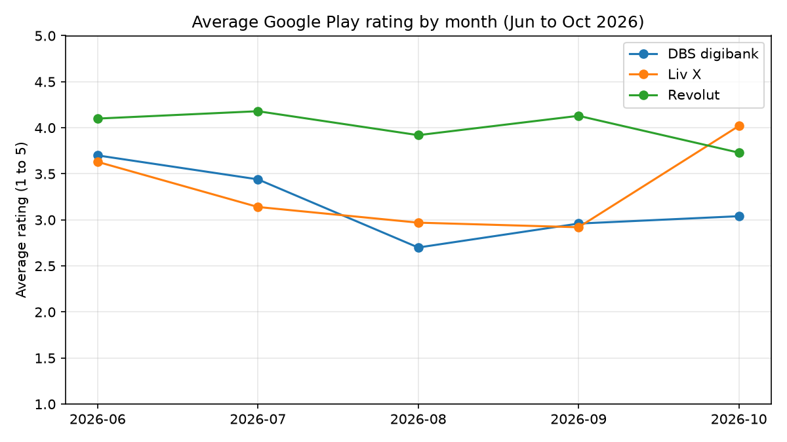

# Bank Review Sentiment Bot: Revolut vs DBS digibank vs Liv X

A free, local Python project that builds its own ranking of three digital banks from real customer reviews, instead of trusting the star ratings shown in app stores.

- **Banks:** Revolut (London), DBS digibank (Singapore), Liv X by Emirates NBD (Dubai)
- **Data:** 11,882 Google Play reviews, 25 May to 13 Nov 2026 (Revolut 9,795, DBS 1,580, Liv X 507)
- **Tools:** Python, pandas, VADER, matplotlib. No paid tools, no paid API.

## Results

| Rank | Bank | Reviews | Avg rating (± margin of error) | Positive | Negative | Net sentiment |
|---|---|---|---|---|---|---|
| 1 | Revolut | 9,795 | 4.00 ± 0.03 | 74.9% | 22.7% | **+52.2** |
| 2 | Liv X | 507 | 3.48 ± 0.16 | 60.9% | 35.7% | **+25.2** |
| 3 | DBS digibank | 1,580 | 2.92 ± 0.09 | 46.1% | 50.1% | **-4.0** |

*Net sentiment = % positive reviews (4-5 stars) minus % negative reviews (1-2 stars).* The margins of error do not overlap, so the three banks differ on the full data.

### Key findings

1. **Revolut leads** on every measure. Its biggest complaint theme is blocked accounts and identity checks (19.9% of 1-2 star reviews).
2. **DBS has an app problem, not a people problem.** App bugs (35%) and login (32%) lead its complaints. Customer support is only 4%.
3. **DBS dropped sharply in August 2026.** Its 1-2 star share rose from 35% to 55%. Complaints about app bugs and speed went from 7.7% to 25.8% of all reviews that month.
4. **Revolut dipped in October 2026.** Its 1-2 star share rose from 21% to 29%, spread across app bugs, transfers, login and cards.
5. **Liv X's main complaint is customer support** (25% of its 1-2 star reviews).
6. **Short reviews inflate ratings.** Using only reviews with 20 or more characters of text (June to October), average ratings fall to Revolut 3.62, Liv X 2.60 and DBS 2.37. On this view, Liv X and DBS are close.

### Monthly trend (full months only)



| Average rating | Jun | Jul | Aug | Sep | Oct |
|---|---|---|---|---|---|
| Revolut | 4.10 | 4.18 | 3.92 | 4.13 | 3.73 |
| DBS digibank | 3.70 | 3.44 | 2.70 | 2.96 | 3.04 |
| Liv X | 3.63 | 3.14 | 2.97 | 2.92 | 4.02 |

Do not read Liv X's October jump as an improvement. In October, 52% of its reviews were very short ("nice", "wow", "Good"), against 21% in September. The mix of reviewers changed. Using only substantive reviews the jump is much smaller (2.59 to 3.12) and rests on 48 reviews.

## How it works

| Step | Script | What it does |
|---|---|---|
| 1 | `scrape_reviews.py` | Collects Google Play reviews into `bank_reviews.csv` |
| 2 | `make_clean.py` | Removes duplicates, fixes one shared date window, parks banks with too few reviews |
| 3 | `score_sentiment_v2.py` | Final sentiment label from stars. VADER (with a custom banking word list) is a cross-check |
| 4 | `find_themes.py` | Tags 11 themes (login, app bugs, support, fees, blocked accounts and so on) with keyword rules |
| 5 | `ranking.py` | Ranking by net sentiment, with margin of error |
| 6 | `trend.py` | Monthly trend and chart |
| 7 | `change_drivers.py` | Which themes grew in the bad months |
| 8 | `robust_check.py` | Repeats the numbers using only reviews with 20+ characters |

`spot_check.py` and `liv_check.py` are the manual checks described below.

## Checks and mistakes I caught

- **VADER alone missed many complaints.** Only 52.9% of 1-2 star reviews were scored negative, because banking complaints are often plain facts ("can't log in", "card blocked"). After adding banking words it rose to 59.6%. Text and stars agree on 76.5% of reviews overall. The final label therefore comes from the star rating.
- **My first "fraud and security" theme was wrong.** Reading real reviews showed most of them were about the GrapheneOS phone system, not fraud. I split it into "Fraud and scams" and "Device and OS support".
- **Liv X's October jump was not real improvement** (see above).
- **Wio Bank was dropped from the ranking.** Google Play returned only 733 reviews with text (107 in the window). That is too few for a fair comparison, so Liv X represents Dubai.

## Limits

- Google Play only, English reviews, one app per bank. App Store and Trustpilot are not included yet.
- Reviewers are not all customers. People who are angry or very happy write reviews more often.
- Themes come from keyword rules. Coverage is 68-72% of complaints but only 22-33% of praise, because many happy reviews say only "good app".
- Liv X has few reviews (507), so its monthly numbers move a lot.
- The data shows what changed and when. It cannot prove why.
- Star ratings are not money. This version does not estimate churn or cost.

## Run it

```bash
python3 -m venv venv
source venv/bin/activate
pip install -r requirements.txt
bash run_all.sh
```

Google Play data changes over time, so a new run will give slightly different numbers. The date window is set inside `make_clean.py`.

## Data note

Raw review text is not published in this repository. It was collected for personal study and portfolio use. Only aggregated results (`ranking.csv`, `monthly_trend.csv`) are included.

## Next

- Add App Store and Trustpilot reviews for more volume
- Early warning when complaints spike
- Fix-priority engine: rank problems by customers affected and money at risk
- Marketing message tester: do a bank's promises match what customers say?
- Free local AI model for summaries

## Author

Rahul Upasani, MGB student at S P Jain School of Global Management (Marketing major, Finance minor). MIT licence.
